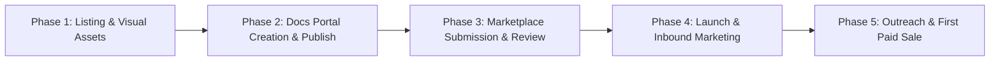
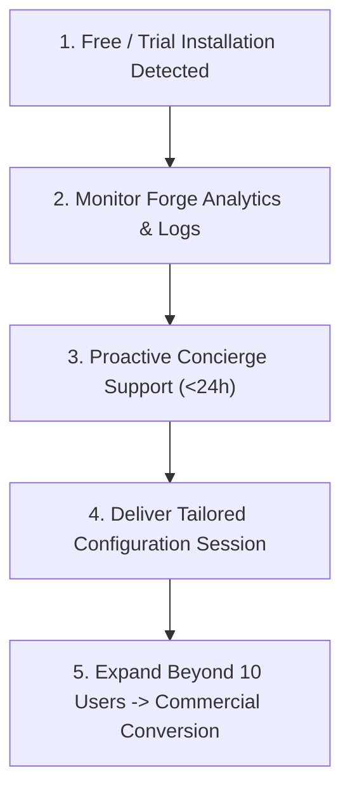

# Asymm Systems Jira Governance Suite: End-to-End Launch & First Sale Playbook

> **Target Goal:** Take the entire Asymm Systems Jira Suite (**LedgerSeal**, **DefinitionGuard**, **FourRealities**, **PlanShift**) from post-build to official Atlassian Marketplace publication, comprehensive hosted documentation, active community marketing, and securing the **first commercial paying sale**.
>
> **Target Audience:** Engineering Leads, Release Managers, Quality/Compliance Managers (SOC 2, ISO 27001, GxP/MedTech, FinTech) using Jira Cloud.
>
> **Publisher:** Asymm Systems (`asymm.systems`)  
> **Architecture Guarantee:** 100% Atlassian Forge Native (Zero egress, runs entirely within customer Atlassian tenant, data privacy by design).

---

## 1. Suite Product Architecture & Positioning

The suite is positioned as **"The Zero-Trust Jira Governance & Integrity Platform"**:

| App | Primary Value Proposition | Key Differentiating Capability | Workflow Hook |
|---|---|---|---|
| **LedgerSeal** | Tamper-Evident Approval Seals | Ties approvals to content with SHA-256 snapshot hashes, Ed25519 signatures, and change attribution. | Transition validator blocks if modified after approval. |
| **DefinitionGuard** | Enforceable Definition of Done | Per-issue-type DoD criteria, evidence requirements (links/notes), peer-review rules, and audited waivers. | Transition validator blocks move to Done if mandatory items remain open. |
| **FourRealities** | Multi-Perspective Alignment | Reconciles Intent (decisions/specs), Process (Jira), Code (PRs), and Audit (logs) into an objective score. | Issue glance and dashboard view showing real-time alignment drift. |
| **PlanShift** | Scope Creep & Sprint Baseline Control | Tracks baseline scope shifts, sprint commitment tampering, and enforces formal shift approvals. | Issue glance and dashboard tracking scope deltas and baseline changes. |

---

## 2. Phase-by-Phase Execution Roadmap



---

## Phase 1: Marketplace Listings & High-Fidelity Assets (All 4 Apps)

### 1.1 Marketplace Copy Requirements
For each app, ensure its listing file under `docs/marketplace/` meets Atlassian Marketplace standards:
- **LedgerSeal:** `docs/marketplace/ledgerseal-listing.md`
- **DefinitionGuard:** `docs/marketplace/definitionguard-listing-v2.md`
- **FourRealities:** `docs/marketplace/fourrealities-listing.md`
- **PlanShift:** `docs/marketplace/planshift-listing.md`

#### Required Copy Sections for Each App:
1. **App Title & Punchy Tagline (Max 80 chars):** State the precise capability without marketing buzzwords.
2. **Short Highlight Description (Max 250 chars):** Immediate hook for search results.
3. **Problem Statement:** Explain what Jira native fails to solve (e.g., Jira change log tracks edits, but cannot prove if approved content was tampered with before release).
4. **Key Capabilities & Proof:** Bulleted features with exact mechanics.
5. **Enterprise Compliance Grounding:** Honest positioning for SOC 2 (CC8.1), ISO 27001 (A.8.32), and FDA 21 CFR Part 11 (explicitly stating limits and what the auditor decides).
6. **Data Privacy & Security:** State "Runs on Atlassian Forge", zero egress, no external database, all data stored in customer's Forge KVS.

### 1.2 Automated Visual Asset Generation Pipeline
Never use mockups or unrendered prototypes. Leverage the automated browser testing pipeline (`docs/design/in-jira-automated-testing-guide.md`) to capture crisp, retina-resolution screenshots from live Jira (`asymmsystems.atlassian.net`):

```bash
# Capture screenshots for all apps across issue panels, glances, and admin pages
node scratch/capture-suite-assets.mjs
```

#### Asset Checklist for Each App (Atlassian Marketplace Specifications):
- [ ] **App Logo / Icon:** 144x144 px PNG (transparent background, high contrast, clean vector style).
- [ ] **Cover Image / Banner:** 2280x1140 px (aspect ratio 2:1, centered hero illustration, minimal text).
- [ ] **Screenshots (Minimum 4, Maximum 10):** 1840x1150 px PNGs:
  1. *Hero View:* Issue panel / glance in standard active state.
  2. *Interactive Action:* Sealing, checking DoD items with evidence, or viewing drift breakdown.
  3. *Transition Enforcement:* Jira workflow transition blocked with clear error dialog.
  4. *Admin Authority Policy:* The unified `AdminPolicyPanel` showing group configuration.
  5. *Attestation & Evidence:* Expanded cryptographic details or exported evidence JSON.

---

## Phase 2: User & Administrator Documentation Portal

### 2.1 Documentation Stack Recommendation
Deploy a clean, lightning-fast documentation site hosted on GitHub Pages or Cloudflare Pages pointing to `docs.asymm.systems`:
- **Engine:** Starlight (Astro) or VitePress.
- **Source Directory:** `docs/user-guide/` in the monorepo.
- **Theme:** Clean technical documentation matching Atlassian Design System tokens (neutral backgrounds, crisp typography, dark/light toggle).

### 2.2 Documentation Architecture (Sitemap)

```
docs.asymm.systems/
├── index.md                      # Suite Overview: The Zero-Trust Jira Governance Platform
├── quickstart.md                 # 5-Minute Evaluation Guide (Installing from Marketplace)
├── security-and-privacy.md       # Architecture, Forge isolation, Zero-Egress disclosure
├── permissions.md                # Admin Guide: The Uniform Permission Management Standard
├── apps/
│   ├── ledgerseal/
│   │   ├── index.md              # Overview, How Tamper-Evident Seals Work
│   │   ├── admin-guide.md        # Configuring Approver Groups & Workflow Validators
│   │   ├── user-guide.md         # Sealing, Resealing, Revoking, Viewing Differences
│   │   ├── compliance-mapping.md # SOC 2 & 21 CFR Part 11 Alignment
│   │   └── open-verifier.md      # Standalone Node.js offline Ed25519 verification script
│   ├── definitionguard/
│   │   ├── index.md              # Overview, Enforceable Definition of Done
│   │   ├── admin-guide.md        # Setting up Issue Type Checklists & Done Transition Gates
│   │   ├── user-guide.md         # Ticking items, Submitting Evidence links, Requesting Waivers
│   │   └── coverage-report.md    # Using the Transition Coverage Check
│   ├── fourrealities/
│   │   ├── index.md              # Overview: Intent, Process, Code, Audit
│   │   ├── integration.md        # Connecting Git Repositories and Confluence Decision Records
│   │   └── drift-management.md   # Interpreting Risk Levels and Resolving Drift
│   └── planshift/
│       ├── index.md              # Overview: Sprint Baseline Protection
│       ├── baseline-setup.md     # Freezing Sprint Commitments
│       └── shift-approvals.md    # Managing Scope Additions and Approvals
└── faq.md                        # Licensing, Cloud Fortified, Troubleshooting
```

### 2.3 Standalone Verifier Publication (LedgerSeal USP)
Publish the open-source Node verification script directly in the docs and in a public repository (`asymm-systems/ledgerseal-verifier`):
- Uses **zero dependencies** (`node:crypto` standard library only).
- Allows external compliance auditors to verify signed attestations offline against the published public key (`keys/ls-dev-2026-11.pub.pem`).

---

## Phase 3: Marketplace Submission & Approval

### 3.1 Atlassian Developer Console Checklist
For each of the 4 apps on [developer.atlassian.com/console](https://developer.atlassian.com/console):
1. **Licensing:** Enable paid via Atlassian (or free with paid tier).
2. **Pricing Structure (Standardized Across Suite):**
   - **Up to 10 Users:** **Free** (The wedge for self-serve trials and small teams).
   - **11 to 100 Users:** **\$1.50 per user/month** (e.g. 50 users = \$75/mo).
   - **101 to 250 Users:** **\$1.20 per user/month**.
   - **251 to 1,000 Users:** **\$0.90 per user/month**.
3. **Cloud Security & Privacy Tab:**
   - Complete the Atlassian Security Self-Assessment.
   - Confirm "No external data storage" and "No outbound network traffic".
   - Link to Privacy Policy: `https://asymm.systems/privacy`
   - Link to Terms of Service: `https://asymm.systems/terms`
   - Link to Support: `https://asymm.systems/support` (or email `support@asymm.systems`)

---

## Phase 4: Launch & Targeted Inbound Marketing

### 4.1 Launch Strategy: The "Zero-Trust Jira" Wedge
Do not market the apps as generic utility gadgets. Market them as the missing **Change Control & Integrity Layer** for regulated Jira users.

#### High-Leverage Content Angles:
1. **Technical Blog Post / Case Study:**
   - *Title:* "Why Jira's Change Log Isn't Change Control: The Approved Ticket Problem"
   - *Core Narrative:* Demonstrating how an approved ticket can have its description, acceptance criteria, or attachments modified right before a release without breaking standard workflow transitions.
   - *Solution:* How LedgerSeal and DefinitionGuard turn Jira into a closed-loop system where unverified changes are caught automatically.
2. **Interactive Video Walkthroughs (60-90 Seconds):**
   - Record tight, high-framerate screencasts of:
     - Sealing an issue in LedgerSeal -> Editing description -> Watching status turn orange `CHANGED` -> Workflow transition getting blocked.
     - DefinitionGuard enforcing a peer review waiver reason before ticket resolution.

### 4.2 Distribution Channels
- **Atlassian Community:**
  - Participate in discussions tagged `jira-cloud`, `compliance`, `change-management`, and `automation`.
  - Share open-source verifier scripts and technical explainers on Forge architecture.
- **LinkedIn / Tech Twitter:**
  - Target QA Directors, VP of Engineering, Heads of Compliance in FinTech and HealthTech.
  - Highlight the "Runs on Atlassian" security model (no external servers, no SOC 2 questionnaire friction for buyers).
- **Reddit (r/jira, r/devops, r/compliance):**
  - Share the problem analysis: "How we solved post-approval tampering in Jira Cloud using Atlassian Forge".

---

## Phase 5: The First Sale Playbook (From Install to Paid License)

### 5.1 The 1-10 Free User Wedge
Because Atlassian Cloud offers free licensing for up to 10 users, small teams and engineering leads can install the apps with zero procurement friction or credit card entry.

### 5.2 Converting Trials into the First Paying Customer



#### Step 1: Real-Time Trial Telemetry
- Check the Atlassian Marketplace Vendor Insights daily for new site installations.
- Use `forge logs` (or site telemetry) to monitor initial onboarding health and ensure customers do not get stuck on permissions.

#### Step 2: Proactive Concierge Onboarding (< 24 Hours)
When a new domain installs:
- Reach out with personalized, non-salesy technical assistance:
  > *"Hi [Name], saw you installed LedgerSeal on your Jira instance. I am Fahim, the creator. If you need help configuring your approver groups or attaching the workflow transition validator to your software boards, I am happy to hop on a quick 15-minute async screen share or configure a sample workflow for you."*

#### Step 3: Remove All Organizational Friction
- **Security Review Acceleration:** Provide an immediate pre-filled Security & Architecture One-Pager showing that the app runs 100% inside Atlassian Forge with zero external egress.
- **Expansion Wedge:** Once an engineering lead seals their first 20 tickets or sets up DefinitionGuard for their primary sprint board, offer to assist in rolling the configuration out to their entire engineering team (crossing the 10-user threshold into the paid tier).

---

## Prompt Template for Subordinate Sessions

```markdown
You are executing Phase [1 | 2 | 3 | 4 | 5] of the Asymm Systems Jira Governance Suite Launch Playbook.
All work must follow docs/marketplace/suite-launch-and-first-sale-playbook.md and the monorepo engineering standards:
1. Zero raw Atlassian tokens outside packages/asymm-jira-ui.
2. Zero em dashes in all documentation, code, and commit messages.
3. Use automated headless browser scripts with session cookies (docs/design/in-jira-automated-testing-guide.md) for all visual evidence.
4. Maintain 100% pass on all 36 test suites and >=95% branch coverage.
Your specific milestone: [INSERT SPECIFIC TASK HERE].
```
