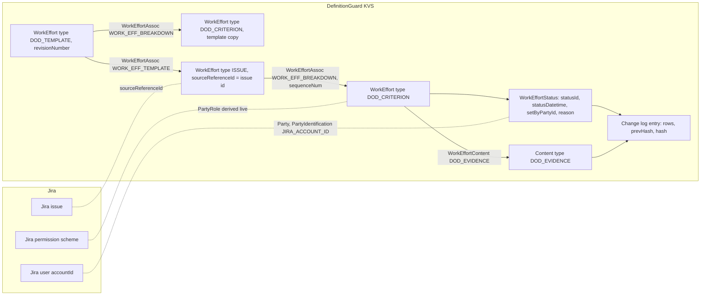

# DefinitionGuard: Architecture Specification v3 (Silverston-aligned domain model)

- **Date:** 2026-11-01
- **Status:** APPROVED 2026-11-01 by the owner, in chat: "approved. A." (decision D3-01 option A). Owner decision 2026-11-01: "C", restructure the domain and storage model to follow the Silverston patterns before B-16.
- **Freezes:** `docs/spec/definitionguard-spec-v2.md` stays as written. v3 replaces only these v2 sections: Domain Model, Storage Schema (record shapes), Gate rule (inputs), and Decisions D-01, D-03, D-13 (see section 9). Everything else in v2 still holds: invariants, write protocol, permission checks, integrity design, resolver contracts, manifest.
- **Backlog:** new item B-21 "Silverston-aligned domain and storage model" (owner decision), before B-16.

## 1. Sources and their limits

| ID | Source | What it supports | Grade |
|---|---|---|---|
| S-01 | Apache OFBiz `applications/datamodel/entitydef/workeffort-entitymodel.xml` (trunk, read 2026-11-01) | WorkEffort, WorkEffortAssoc, WorkEffortStatus, WorkEffortPartyAssignment, WorkEffortContent, WorkEffortAttribute field lists | Observed-code |
| S-02 | OFBiz `framework/common/entitydef/entitymodel.xml` | StatusType, StatusItem, StatusValidChange | Observed-code |
| S-03 | OFBiz `applications/datamodel/entitydef/order-entitymodel.xml` | Requirement, RequirementStatus, WorkRequirementFulfillment | Observed-code |
| S-04 | OFBiz `applications/datamodel/entitydef/party-entitymodel.xml`, `content-entitymodel.xml` | Party, PartyIdentification, PartyRole, RoleType; Content, DataResource | Observed-code |
| S-05 | OFBiz `applications/datamodel/data/seed/WorkEffortSeedData.xml` | WorkEffortAssocType values WORK_EFF_BREAKDOWN and WORK_EFF_TEMPLATE ("Template of"); TASK_STATUS StatusItem and StatusValidChange examples | Observed-code |
| RS-13 | OFBiz project overview (CascadePlan research) | OFBiz chose its data model after "finding The Data Model Resource Book ... by Len Silverston" | Reported |
| CP | `apps/planshift/src/domain/models.ts` (read only) | CascadePlan names: WorkEffort, WorkEffortAssoc, WorkEffortPartyAssignment, RoleType values | Observed-code |

Scratch copies of S-01 to S-05: `~/.cache/gemini-earning-definitionguard-research/sources/ofbiz/`.

**Limit.** I did not read Silverston's books. "Silverston pattern" in this spec means "the pattern as OFBiz implements it". Field names follow OFBiz. Where DefinitionGuard keeps less than OFBiz, section 4 says so.

## 2. The model in one picture



## 3. Mapping table

| DefinitionGuard concept (v2) | Silverston / OFBiz entity | v3 record | Notes |
|---|---|---|---|
| The Jira issue the checklist belongs to | WorkEffort, `workEffortTypeId` ISSUE (S-01) | `issue: WorkEffort` with `sourceReferenceId` = Jira issue id, `workEffortName` = issue key | Jira owns the issue. DefinitionGuard stores only the reference |
| Checklist item | WorkEffort, `workEffortTypeId` DOD_CRITERION, child of the issue WorkEffort through WorkEffortAssoc WORK_EFF_BREAKDOWN with `sequenceNum` (S-01, S-05) | `criteria: CriterionState[]`, each with `workEffortId`, `workEffortName`, `sequenceNum` | Same pattern CascadePlan uses for tasks (CP). Alternative: Requirement (decision D3-01) |
| Mandatory, category, evidence required | WorkEffortAttribute (`attrName`, `attrValue`) (S-01) | Typed fields on the criterion: `isMandatory`, `purposeTypeId` (category), `evidenceRequired` | Typed fields, not name-value rows, so the gate rule stays type-checked. Each field is documented as the WorkEffortAttribute it stands for |
| Template | WorkEffort, `workEffortTypeId` DOD_TEMPLATE, with criterion children; the issue links to it through WorkEffortAssoc WORK_EFF_TEMPLATE ("Template of") (S-05) | `DodTemplate` with `workEffortId`, `revisionNumber`, `criteria` | `revisionNumber` is the OFBiz field for the template version |
| Item state (open, done, waived) | StatusItem in StatusType DOD_CRITERION_STATUS; WorkEffort `currentStatusId`, `lastStatusUpdate` (S-01, S-02) | `currentStatusId`: DOD_OPEN, DOD_DONE, DOD_WAIVED | Section 5 lists the allowed changes |
| Allowed state changes | StatusValidChange (`statusId`, `statusIdTo`, `transitionName`) (S-02) | A fixed table in `src/domain/dod-status.ts`; the fold rejects any other change | New in v3: v2 accepted any change |
| Tick, untick, waive, reset history | WorkEffortStatus (`workEffortId`, `statusId`, `statusDatetime`, `setByUserLogin`, `reason`) (S-01) | Row `WorkEffortStatus` in a change-log entry; `setByPartyId` replaces `setByUserLogin`; the waiver reason goes in `reason` | WorkEffortStatus keys on the datetime, so a status can repeat. RequirementStatus cannot (S-03), see D3-01 |
| Person who acted | Party (PERSON) with PartyIdentification type JIRA_ACCOUNT_ID (S-04) | `partyId` = the Jira accountId | No Party record is stored; Jira is the system of record for people. Names render at view time (v2 D-07) |
| Assignee, reviewer, waiver approver | PartyRole, RoleType, WorkEffortPartyAssignment (S-01, S-04) | Criterion `requiredRoleTypeId`, `excludedRoleTypeId`; template `waiverRoleTypeId` | Roles are derived live from Jira, not stored: role ASSIGNEE = the Jira assignee; role JIRA_PERM_<KEY> = holds that Jira permission on the issue. Section 6 |
| Evidence | Content and DataResource, linked by WorkEffortContent type DOD_EVIDENCE with `fromDate` (S-01, S-04) | Rows `Content` (URL in `objectInfo`, note in `textData`) and `WorkEffortContent` in the same change-log entry as the DONE status | Evidence counts only when its `fromDate` equals the DONE status datetime |
| Event log entry | No single OFBiz entity: OFBiz writes entity rows in one database transaction | `ChangeEntry`: `seq`, `issueId`, `transitionName`, `at`, `actorPartyId`, `rows[]`, `prevHash`, `hash` | One entry = one transaction of entity rows. KVS has no transaction for this layout (v2 R-05), so the entry is the unit of atomicity |
| v1 import | none | Row `LegacyImport` | DefinitionGuard-specific; not Silverston |

## 4. Where v3 keeps less than OFBiz

- No stored Party, PartyRole or WorkEffortPartyAssignment rows. Jira holds people, assignees and permissions, and a stored copy would go stale. The rules read them live, as v2 does.
- No `fromDate` / `thruDate` on criterion associations until B-16 (re-sync). B-16 ends an old criterion association with `thruDate` instead of deleting it.
- WorkEffortAttribute rows are typed fields (section 3).
- Content keeps a link or a note only: no attachments, mime types or locales.

## 5. Status model (StatusItem and StatusValidChange)

| From `statusId` | To `statusIdTo` | `transitionName` | Who |
|---|---|---|---|
| DOD_OPEN | DOD_DONE | Complete | EDIT_ISSUES plus `requiredRoleTypeId`; not `excludedRoleTypeId` |
| DOD_OPEN | DOD_WAIVED | Waive | `waiverRoleTypeId`, with a reason |
| DOD_DONE | DOD_OPEN | Reopen | EDIT_ISSUES |
| DOD_WAIVED | DOD_OPEN | Reopen | `waiverRoleTypeId` |
| any | DOD_OPEN | Reset | ADMINISTER_PROJECTS (one entry, one status row per criterion that was not open, reason "Checklist reset") |

Any other change, for example DOD_DONE to DOD_DONE, is refused before any write: "This item is already done." or "This item is already open."

## 6. Roles derived from Jira

| RoleType | A party holds it when | Read with |
|---|---|---|
| ASSIGNEE | it is the Jira assignee of the issue now | GET issue `fields=assignee` (as the user in resolvers, as the app in the validator) |
| JIRA_PERM_<KEY>, for example JIRA_PERM_RESOLVE_ISSUES | Jira grants permission <KEY> on the issue | GET `/mypermissions?issueKey=` as the user |
| PROJECT_ADMIN | Jira grants ADMINISTER_PROJECTS | same |

The settings page still shows these as plain choices ("Resolve issues", "Not the assignee"). The validator re-checks `excludedRoleTypeId` ASSIGNEE at the moment of Done (v2 D-04).

## 7. Record shapes

```typescript
type DodStatusId = 'DOD_OPEN' | 'DOD_DONE' | 'DOD_WAIVED';
type RoleTypeId = 'ASSIGNEE' | 'PROJECT_ADMIN' | `JIRA_PERM_${string}`;

interface WorkEffortRef { workEffortId: string; workEffortTypeId: 'ISSUE'; sourceReferenceId: string; workEffortName: string; projectId: string }

interface CriterionState {                 // a DOD_CRITERION WorkEffort, cached
  workEffortId: string;                    // `crit:<issueId>:<templateItemId>`
  templateItemId: string;                  // the criterion's id in the template
  workEffortName: string;                  // title
  sequenceNum: number;
  purposeTypeId: ChecklistCategory;        // WorkEffort.workEffortPurposeTypeId
  isMandatory: boolean;                    // WorkEffortAttribute "mandatory"
  evidenceRequired: boolean;               // WorkEffortAttribute "evidenceRequired"
  requiredRoleTypeId?: RoleTypeId;
  excludedRoleTypeId?: 'ASSIGNEE';
  currentStatusId: DodStatusId;
  lastStatusUpdate?: string;
  lastStatusByPartyId?: string;
  lastStatusSeq?: number;                  // change entry that set the status
  evidenceContentId?: string;              // WorkEffortContent DOD_EVIDENCE for the current DONE
  legacyName?: string;                     // v1 display name, only when v1 had no accountId
}

interface DodState {                       // dg:state:<issueId>, a cache of the change log
  schemaVersion: 3;
  issue: WorkEffortRef;
  template: { workEffortId: string; revisionNumber: number; waiverRoleTypeId: RoleTypeId };
  criteria: CriterionState[];
  seq: number; headHash: string;
  lastModifiedAt?: string; lastModifiedByPartyId?: string;
  legacy?: LegacyRef;
}

type DodRow =
  | { entity: 'WorkEffort'; workEffortId: string; workEffortTypeId: 'ISSUE' | 'DOD_CRITERION'; workEffortName: string; sourceReferenceId?: string;
      purposeTypeId?: ChecklistCategory; isMandatory?: boolean; evidenceRequired?: boolean; requiredRoleTypeId?: RoleTypeId; excludedRoleTypeId?: 'ASSIGNEE'; templateItemId?: string }
  | { entity: 'WorkEffortAssoc'; workEffortIdFrom: string; workEffortIdTo: string; workEffortAssocTypeId: 'WORK_EFF_BREAKDOWN' | 'WORK_EFF_TEMPLATE'; sequenceNum?: number; fromDate: string; thruDate?: string; revisionNumber?: number }
  | { entity: 'WorkEffortStatus'; workEffortId: string; statusId: DodStatusId; statusDatetime: string; setByPartyId: string; reason?: string }
  | { entity: 'Content'; contentId: string; contentTypeId: 'DOD_EVIDENCE'; objectInfo?: string; textData?: string }
  | { entity: 'WorkEffortContent'; workEffortId: string; contentId: string; workEffortContentTypeId: 'DOD_EVIDENCE'; fromDate: string }
  | { entity: 'LegacyImport'; legacy: LegacyRef };

interface ChangeEntry {                    // dg:evt:<issueId>:<seq 8 digits>, append-only
  seq: number; issueId: string;
  transitionName: 'Create' | 'Migrate' | 'Complete' | 'Reopen' | 'Waive' | 'Reset' | 'Resync';
  at: string; actorPartyId: string;
  rows: DodRow[];
  prevHash: string; hash: string;
}
```

Keys, the write protocol (`FAIL_IF_EXISTS` on the next entry), fold-forward, history paging, chain verification and the signed property are unchanged from v2. The hash covers the whole entry, rows included.

## 8. Contracts that do not change

To stop the churn seen in B-03 to B-14, these are frozen for B-21:

- The panel response (`IssueChecklistState` adapter in `src/index.ts`) and every resolver name and payload. `src/ui/*`, `src/frontend/*` and their tests do not change.
- The settings payload for templates (name, items with id, title, isMandatory, category, evidenceRequired, notAssignee, requiredPermission). The settings resolver converts it to `DodTemplate` on save.
- The `definitionguard-dod` property schema v2 and the validator messages.
- The v1 migration path (`dg:checklist:<issueId>` read only, MIGRATED entry). v2 records do not exist on any site: the v2 code was never deployed, so no v2-to-v3 migration is needed.

## 9. Decisions

| ID | Decision | Options considered | Reason |
|---|---|---|---|
| D3-01 | A criterion is a child WorkEffort (DOD_CRITERION) of the issue WorkEffort, with WorkEffortStatus history | (A) child WorkEffort; (B) Requirement fulfilled by the issue WorkEffort (WorkRequirementFulfillment) with RequirementStatus | (A) matches CascadePlan (one portfolio model, CP). WorkEffortStatus allows repeated statuses and has `reason` (S-01); RequirementStatus keys on (requirementId, statusId), so a tick after an untick cannot be recorded, and it has no reason field (S-03). (B) reads closer to "acceptance criteria", but needs a non-OFBiz status history |
| D3-02 | One change-log entry = one transaction of entity rows | One row per entry | Keeps a tick with its evidence atomic under the single `FAIL_IF_EXISTS` lock (v2 D-01) |
| D3-03 | Roles are derived live from Jira, not stored as PartyRole rows | Store PartyRole and WorkEffortPartyAssignment | Jira is the system of record; stored copies go stale and would need sync |
| D3-04 | StatusValidChange is enforced in the fold and in the resolvers | Accept any change (v2) | A status model that allows DONE to DONE records ticks that mean nothing |
| D3-05 | Evidence is Content linked by WorkEffortContent with `fromDate` = the DONE `statusDatetime` | Evidence inside the status row (v2) | Follows S-01. Evidence stays tied to the tick it supports; a later reopen ends it |
| D3-06 | Typed fields for WorkEffortAttribute values | Name-value rows | The gate rule stays type-checked; the mapping is documented in section 3 |
| D3-07 | Replaces v2 D-01 (record shape only), D-03 (permission keys become RoleType JIRA_PERM_<KEY>, same check), D-13 (evidence location) | | |

## 10. Build plan for B-21 (after approval)

1. Tests first: status valid changes; fold of each row type; criterion and evidence rules in the gate; template conversion; chain over entries with rows; the frozen panel response for the same scenarios as today.
2. Rewrite `src/domain/models.ts` (v3 types beside the v1 types), `src/domain/event-log.ts` (entries and rows), new `src/domain/dod-status.ts`, `src/domain/gate-rule.ts` (criteria), `src/settings/template-store.ts` (DodTemplate), the resolvers' change functions, and the adapter.
3. Rewrite the tests that read raw records: store, resolvers, evidence, roles and waivers, chain, budget, export (about 120 assertions on `.type`, `.items`, `.evidence`, `.reason`). UI and view-model tests stay as they are.
4. Re-run the harness and all section 11.2 checks. One commit, `Refs: B-21`.

Estimated effort: 1 to 2 days of session time.
